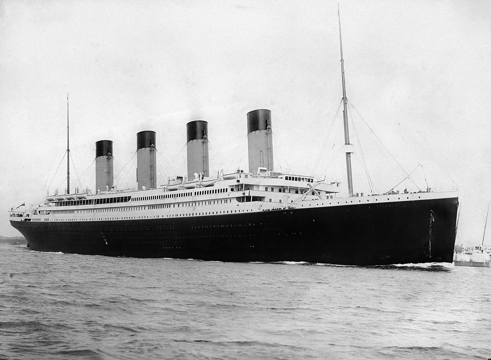

```{r setup, include=FALSE}
knitr::opts_chunk$set(echo = TRUE, message = FALSE,
                      warning = FALSE)
```

```{r packages}
library(tidyverse)
library(tidymodels)
library(discrim)
library(kknn)
library(corrplot)
tidymodels_prefer()

set.seed(231)

titanic <- read_csv("data/titanic.csv") %>%
  mutate(survived = factor(survived, levels = c("Yes", "No")),
         pclass = factor(pclass))
```

## Binary Classification

For this assignment, we will be working with part of a [Kaggle data set](https://www.kaggle.com/c/titanic/overview) that was the subject of a machine learning competition and is often used for practicing ML models. The goal is classification; specifically, to predict which passengers would survive the [Titanic shipwreck](https://en.wikipedia.org/wiki/Titanic).

{width="363"}

Load the data from `data/titanic.csv` into *R* and familiarize yourself with the variables it contains using the codebook (`data/titanic_codebook.txt`).

Notice that `survived` and `pclass` should be changed to factors. When changing `survived` to a factor, you may want to reorder the factor so that *"Yes"* is the first level.

Make sure you load the `tidyverse` and `tidymodels`!

*Remember that you'll need to set a seed at the beginning of the document to reproduce your results.*

### Question 1

Split the data, stratifying on the outcome variable, `survived.` You should choose the proportions to split the data into. Verify that the training and testing data sets have the appropriate number of observations. Take a look at the training data and note any potential issues, such as missing data.

Why is it a good idea to use stratified sampling for this data?

```{r q1}
titanic_split <- initial_split(titanic, prop = 0.75, strata = survived)
titanic_train <- training(titanic_split)
titanic_test  <- testing(titanic_split)

dim(titanic_train)
dim(titanic_test)

colSums(is.na(titanic_train))

titanic_train %>%
  select(age, sib_sp, parch, fare) %>%
  summary()
```

I used a 75/25 split, stratified on `survived`. The training set has 667 observations and the testing set has 224. These add up to the full 891, and the training set is about 75% of the data ($667/891 \approx 0.749$), so the split worked as expected.

Potential issues in the training data:

-   **`cabin`** is missing for 510 passengers (about 76%), so it would be hard to use as a predictor.
-   **`age`** is missing for 134 passengers (about 20%). This is a lot to throw away, which is why we impute it in Question 4.
-   **`embarked`** is missing for 2 passengers.
-   **`fare`** is very right-skewed. The median is 15 but the maximum is about 512, and 10 passengers have a fare of 0.
-   **`name`** and **`ticket`** are close to unique identifiers, so they aren't useful as predictors without more processing.

Stratified sampling is a good idea because the classes are not balanced: only about 38% of passengers survived. Stratifying keeps that proportion about the same in both sets, so neither one ends up with an unusual share of survivors by chance. Here, 38.4% of both the training and testing sets survived. This matters for the fitted models, and it also means the testing set gives a fairer estimate of performance.

### Question 2

Using the **training** data set, explore/describe the distribution of the outcome variable `survived`.

Create a [percent stacked bar chart](https://r-graph-gallery.com/48-grouped-barplot-with-ggplot2) (recommend using `ggplot`) with `survived` on the *x*-axis and `fill = sex`. Do you think `sex` will be a good predictor of the outcome?

Create one more percent stacked bar chart of `survived`, this time with `fill = pclass`. Do you think passenger class will be a good predictor of the outcome?

Why do you think it might be more useful to use a [percent stacked bar chart](https://r-graph-gallery.com/48-grouped-barplot-with-ggplot2) as opposed to a traditional stacked bar chart?

```{r q2-outcome}
titanic_train %>%
  count(survived) %>%
  mutate(prop = n / sum(n))

titanic_train %>%
  ggplot(aes(x = survived)) +
  geom_bar(fill = "steelblue") +
  labs(title = "Distribution of Survival", x = "Survived", y = "Count")
```

The outcome is moderately imbalanced. In the training set, 256 passengers survived (38.4%) and 411 did not (61.6%). A model that always predicted "No" would be right about 62% of the time, so accuracy alone can be misleading here.

```{r q2-sex}
titanic_train %>%
  ggplot(aes(x = survived, fill = sex)) +
  geom_bar(position = "fill") +
  scale_y_continuous(labels = scales::percent) +
  labs(title = "Sex by Survival", x = "Survived", y = "Percent", fill = "Sex")
```

Yes, `sex` looks like it will be a very good predictor. About 71% of survivors were female, while about 85% of those who did not survive were male. Put another way, about 75% of female passengers survived compared to only about 18% of male passengers.

```{r q2-pclass}
titanic_train %>%
  ggplot(aes(x = survived, fill = pclass)) +
  geom_bar(position = "fill") +
  scale_y_continuous(labels = scales::percent) +
  labs(title = "Ticket Class by Survival", x = "Survived", y = "Percent",
       fill = "Ticket class")
```

Yes, passenger class also looks like a good predictor, although the difference is less extreme than for `sex`. Third class makes up about 66% of those who did not survive but only about 35% of survivors, while first class makes up about 16% of those who did not survive and about 41% of survivors. The survival rate falls with each class: about 61% in first class, 46% in second class, and 25% in third class.

A percent stacked bar chart is more useful here because the two outcome groups have different sizes (411 vs. 256). Making each bar the same height means we can directly compare the *makeup* of the groups. In a traditional stacked bar chart, the segments start at different heights and the bars have different totals, so these comparisons are harder to judge by eye. The tradeoff is that a percent chart hides the actual counts, which is why I looked at the outcome distribution separately first.

### Question 3

Using the **training** data set, create a correlation matrix of all continuous variables. Visualize the matrix and describe any patterns you see. Are any predictors correlated with each other? Which ones, and in which direction?

```{r q3}
titanic_cor <- titanic_train %>%
  select(age, sib_sp, parch, fare) %>%
  cor(use = "pairwise.complete.obs")

round(titanic_cor, 3)

corrplot(titanic_cor, method = "color", type = "lower", diag = FALSE,
         addCoef.col = "black", tl.col = "black", tl.srt = 45)
```

I used `age`, `sib_sp`, `parch`, and `fare`. I left out `passenger_id` because it is only a row label, and `pclass` because it is a categorical variable. `sib_sp` and `parch` are counts rather than truly continuous, but they are numeric, so I included them. Since `age` has missing values, each correlation uses all pairs of values that are available.

None of the correlations are very strong, so no two predictors are close to redundant. The patterns are:

-   **`sib_sp` and `parch` are positively correlated** ($r \approx 0.41$), the strongest relationship in the matrix. This makes sense because passengers traveling with family often have both kinds of relatives aboard.
-   **`age` is negatively correlated with `sib_sp`** ($r \approx -0.30$) **and `parch`** ($r \approx -0.20$). Younger passengers tended to have more family aboard, such as children traveling with parents and siblings.
-   **`fare` is weakly positively correlated with `parch`** ($r \approx 0.22$) **and `sib_sp`** ($r \approx 0.15$). One possible reason is that a single ticket could cover several family members, but the data here can't confirm that.
-   **`fare` and `age` have almost no correlation** ($r \approx 0.09$).

### Question 4

Using the **training** data, create a recipe predicting the outcome variable `survived`. Include the following predictors: ticket class, sex, age, number of siblings or spouses aboard, number of parents or children aboard, and passenger fare.

Recall that there were missing values for `age`. To deal with this, add an imputation step using `step_impute_linear()`. Next, use `step_dummy()` to **dummy** encode categorical predictors. Finally, include interactions between:

-   Sex and passenger fare, and
-   Age and passenger fare.

You'll need to investigate the `tidymodels` documentation to find the appropriate step functions to use.

```{r q4}
titanic_recipe <- recipe(survived ~ pclass + sex + age + sib_sp + parch + fare,
                         data = titanic_train) %>%
  step_impute_linear(age, impute_with = imp_vars(pclass, sex, sib_sp, parch, fare)) %>%
  step_dummy(all_nominal_predictors()) %>%
  step_interact(terms = ~ starts_with("sex"):fare + age:fare)

tidy(titanic_recipe)

prep(titanic_recipe) %>%
  bake(new_data = NULL) %>%
  head()
```

Missing ages are predicted from the other five predictors with a linear regression. The dummy step comes before the interaction step because `step_interact()` needs numeric columns, so `sex` has to be `sex_male` by then.

### Question 5

Specify a **logistic regression** model for classification using the `"glm"` engine. Then create a workflow. Add your model and the appropriate recipe. Finally, use `fit()` to apply your workflow to the **training** data.

***Hint: Make sure to store the results of `fit()`. You'll need them later on.***

```{r q5}
log_model <- logistic_reg() %>%
  set_engine("glm") %>%
  set_mode("classification")

log_workflow <- workflow() %>%
  add_model(log_model) %>%
  add_recipe(titanic_recipe)

log_fit <- fit(log_workflow, titanic_train)
```

### Question 6

**Repeat Question 5**, but this time specify a linear discriminant analysis model for classification using the `"MASS"` engine.

```{r q6}
lda_model <- discrim_linear() %>%
  set_engine("MASS") %>%
  set_mode("classification")

lda_workflow <- workflow() %>%
  add_model(lda_model) %>%
  add_recipe(titanic_recipe)

lda_fit <- fit(lda_workflow, titanic_train)
```

### Question 7

**Repeat Question 5**, but this time specify a quadratic discriminant analysis model for classification using the `"MASS"` engine.

```{r q7}
qda_model <- discrim_quad() %>%
  set_engine("MASS") %>%
  set_mode("classification")

qda_workflow <- workflow() %>%
  add_model(qda_model) %>%
  add_recipe(titanic_recipe)

qda_fit <- fit(qda_workflow, titanic_train)
```

### Question 8

**Repeat Question 5**, but this time specify a *k*-nearest neighbors model for classification using the `"kknn"` engine. Choose a value for *k* to try.

```{r q8}
knn_model <- nearest_neighbor(neighbors = 7) %>%
  set_engine("kknn") %>%
  set_mode("classification")

knn_workflow <- workflow() %>%
  add_model(knn_model) %>%
  add_recipe(titanic_recipe)

knn_fit <- fit(knn_workflow, titanic_train)
```

I chose $k = 7$, the same value used in Homework 2. The recipe doesn't center or scale the predictors, but the `kknn` engine scales them by default, so a large-valued variable like `fare_x_age` doesn't dominate the distance calculation.

### Question 9

Now you've fit four different models to your training data.

Use `predict()` and `bind_cols()` to generate predictions using each of these 4 models and your **training** data. Then use the metric of **area under the ROC curve** to assess the performance of each of the four models.

```{r q9}
get_aucs <- function(data) {
  bind_cols(
    data %>% select(survived),
    predict(log_fit, data, type = "prob") %>% select(logistic = .pred_Yes),
    predict(lda_fit, data, type = "prob") %>% select(lda = .pred_Yes),
    predict(qda_fit, data, type = "prob") %>% select(qda = .pred_Yes),
    predict(knn_fit, data, type = "prob") %>% select(knn = .pred_Yes)
  ) %>%
    pivot_longer(-survived, names_to = "model", values_to = "pred_yes") %>%
    group_by(model) %>%
    roc_auc(survived, pred_yes) %>%
    arrange(desc(.estimate))
}

train_aucs <- get_aucs(titanic_train)
train_aucs
```

On the training data, KNN has by far the highest AUC (0.976), and the other three are nearly tied: QDA (0.865), logistic regression (0.864), and LDA (0.863). KNN's score is too optimistic, though. Each training observation is its own nearest neighbor when we predict on the training set, so the model partly gets to see the answer.

### Question 10

Fit all four models to your **testing** data and report the AUC of each model on the **testing** data. Which model achieved the highest AUC on the **testing** data?

Using your top-performing model, create a confusion matrix and visualize it. Create a plot of its ROC curve.

How did your best model perform? Compare its **training** and **testing** AUC values. If the values differ, why do you think this is so?

```{r q10-auc}
test_aucs <- get_aucs(titanic_test)
test_aucs
```

I used the models that were already fit on the training data to predict the testing data, without refitting them, so the testing data stays unseen. **QDA achieved the highest testing AUC (0.857)**, followed closely by KNN (0.855), then logistic regression (0.834) and LDA (0.832). The gap between QDA and KNN is very small for a testing set of only 224 passengers, so they are effectively tied.

```{r q10-conf-mat}
qda_test_preds <- bind_cols(
  predict(qda_fit, titanic_test, type = "prob"),
  predict(qda_fit, titanic_test),
  titanic_test %>% select(survived)
)

qda_conf_mat <- conf_mat(qda_test_preds, truth = survived, estimate = .pred_class)
qda_conf_mat

autoplot(qda_conf_mat, type = "heatmap")
```

```{r q10-roc}
qda_test_preds %>%
  roc_curve(survived, .pred_Yes) %>%
  autoplot()

bind_rows(
  accuracy(qda_test_preds, survived, .pred_class),
  sensitivity(qda_test_preds, survived, .pred_class),
  specificity(qda_test_preds, survived, .pred_class)
)
```

QDA performed well overall. An AUC of 0.857 is well above the 0.5 expected from random guessing, and the ROC curve stays well above the diagonal. At the default 0.5 probability cutoff, its testing accuracy is about 77.2%, compared to about 61.6% from always predicting "No".

The errors are lopsided, however. The model correctly identifies about 94.2% of non-survivors (130 of 138) but only 50.0% of survivors (43 of 86). A lower probability cutoff would catch more survivors, at the cost of more false positives. Also, KNN had the higher testing accuracy (about 79.5%) even though its AUC was slightly lower, because accuracy depends on one cutoff while AUC summarizes all of them.

QDA's training AUC is 0.865 and its testing AUC is 0.857, a difference of only about 0.007. Testing AUC is slightly lower, which is what we would expect because the model's parameters were chosen to fit the training data, so some of what it learned is specific to that sample. The gap is small, which suggests that QDA is not overfitting much here. KNN is very different: its AUC falls from 0.976 to 0.855, which shows how misleading its training score was. Any single testing AUC also depends on which passengers landed in the testing set, so a different seed could slightly change these numbers and possibly the ranking of QDA and KNN.

### Required for 231 Students

In a binary classification problem, let $p$ represent the probability of class label $1$, which implies that $1 - p$ represents the probability of class label $0$. The *logistic function* (also called the "inverse logit") is the cumulative distribution function of the logistic distribution, which maps a real number *z* to the open interval $(0, 1)$.

### Question 11

Given that:

$$
p(z)=\frac{e^z}{1+e^z}
$$

Prove that the inverse of a logistic function is indeed the *logit* function:

$$
z(p)=ln\left(\frac{p}{1-p}\right)
$$

To find the inverse, we solve $p = \frac{e^z}{1+e^z}$ for $z$, where $p \in (0, 1)$:

$$
\begin{aligned}
p &= \frac{e^z}{1+e^z} \\
p(1 + e^z) &= e^z \\
p + pe^z &= e^z \\
p &= e^z - pe^z \\
p &= e^z(1 - p) \\
\frac{p}{1-p} &= e^z
\end{aligned}
$$

Since $0 < p < 1$, the ratio $\frac{p}{1-p}$ is positive, so we can take the natural log of both sides:

$$
z = ln\left(\frac{p}{1-p}\right)
$$

To confirm that this is the inverse, we can plug it back into the logistic function, using $e^{z(p)} = \frac{p}{1-p}$:

$$
p(z(p)) = \frac{\frac{p}{1-p}}{1 + \frac{p}{1-p}} = \frac{\frac{p}{1-p}}{\frac{(1-p) + p}{1-p}} = \frac{\frac{p}{1-p}}{\frac{1}{1-p}} = p
$$

Therefore, the inverse of the logistic function is the logit function. $\blacksquare$

### Question 12

Assume that $z = \beta_0 + \beta_{1}x_{1}$ and $p = logistic(z)$. How do the odds of the outcome change if you increase $x_{1}$ by two? Demonstrate this.

Assume now that $\beta_1$ is negative. What value does $p$ approach as $x_{1}$ approaches $\infty$? What value does $p$ approach as $x_{1}$ approaches $-\infty$? Demonstrate.

**Change in the odds.** From Question 11, $ln\left(\frac{p}{1-p}\right) = z$, so the odds are:

$$
\text{odds}(x_1) = \frac{p}{1-p} = e^{z} = e^{\beta_0 + \beta_1 x_1}
$$

If we increase $x_1$ by two, the odds become:

$$
\text{odds}(x_1 + 2) = e^{\beta_0 + \beta_1 (x_1 + 2)} = e^{\beta_0 + \beta_1 x_1} \cdot e^{2\beta_1} = \text{odds}(x_1) \cdot e^{2\beta_1}
$$

So increasing $x_1$ by two **multiplies the odds by** $e^{2\beta_1}$, whatever the starting value of $x_1$. The log-odds increase by $2\beta_1$. The odds go up if $\beta_1 > 0$, go down if $\beta_1 < 0$, and stay the same if $\beta_1 = 0$.

**Limits when $\beta_1 < 0$.** Because $\beta_1$ is negative:

As $x_1 \to \infty$, $z = \beta_0 + \beta_1 x_1 \to -\infty$, so $e^z \to 0$ and:

$$
\lim_{x_1 \to \infty} p = \lim_{z \to -\infty} \frac{e^z}{1 + e^z} = \frac{0}{1 + 0} = 0
$$

As $x_1 \to -\infty$, $z = \beta_0 + \beta_1 x_1 \to \infty$. Here $e^z \to \infty$, so we divide the numerator and denominator by $e^z$:

$$
\lim_{x_1 \to -\infty} p = \lim_{z \to \infty} \frac{e^z}{1 + e^z} = \lim_{z \to \infty} \frac{1}{e^{-z} + 1} = \frac{1}{0 + 1} = 1
$$

So $p$ approaches **0** as $x_1 \to \infty$ and approaches **1** as $x_1 \to -\infty$. It never reaches either value, since $p$ stays in the open interval $(0, 1)$.
